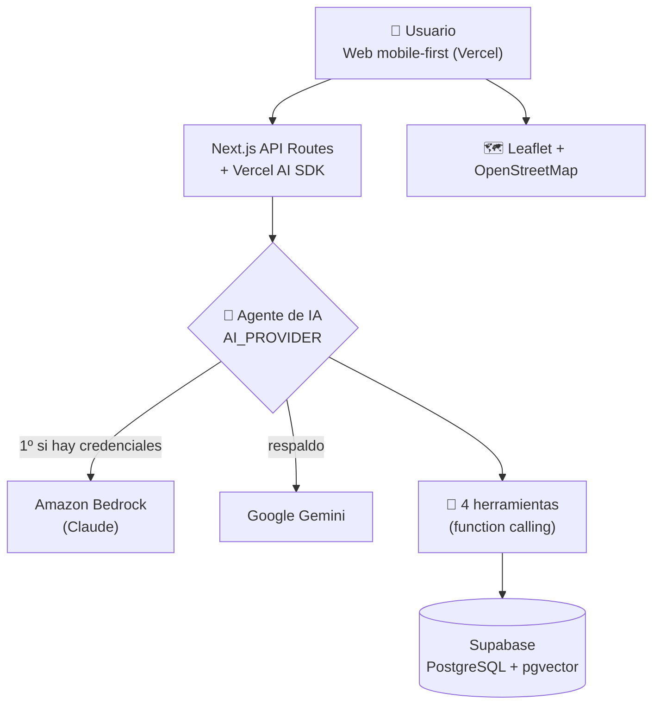
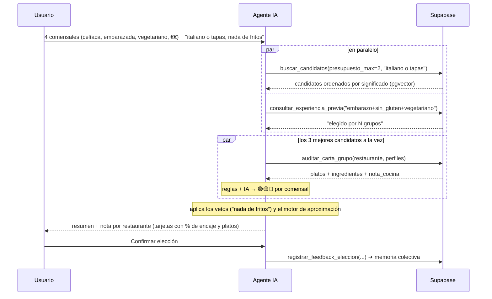
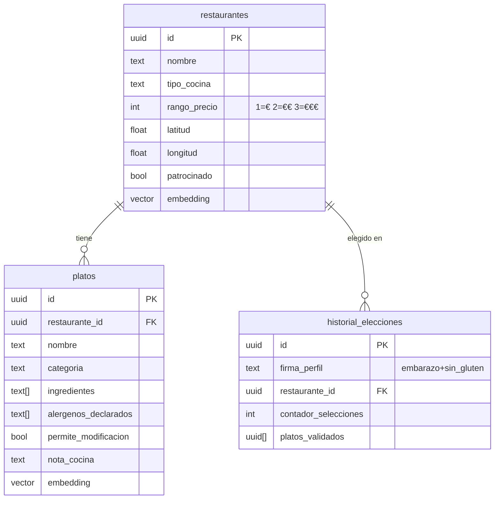

# 🍽️ Agent Locally — Asistente Gastronómico Inteligente

> Un agente de IA que lee la carta por ti y te dice **qué plato puede pedir cada persona de la mesa**, incluso cuando hay celíacos, veganos, alergias o un embarazo en el mismo grupo.

Proyecto del **Seminario & Hackathon de Agentes de IA en AWS · UC3M**.
Equipo: Sergio Brigidano · Lucía Liu Wang · Carlos Velázquez.
Documento de diseño completo: [`SEMINARIO AWS.pdf`](./SEMINARIO%20AWS.pdf).

---

## 1. El problema

Comer fuera con restricciones alimentarias es lento y arriesgado, y **en grupo el problema se multiplica**: una persona celíaca, una embarazada, un vegetariano y alguien con poco presupuesto en la misma mesa.

Las plataformas actuales (Google Maps, TheFork, TripAdvisor) fallan en cuatro puntos:

| # | Limitación actual | Ejemplo |
|---|---|---|
| 1 | **Filtran por local, no por plato.** Un restaurante "con opciones vegetarianas" puede tener solo una ensalada. | No sabes *qué* puede pedir cada persona. |
| 2 | **No entienden matices no estandarizados**, como el embarazo. Solo existen etiquetas para los 14 alérgenos oficiales. | Nadie avisa de que el tiramisú lleva huevo crudo y alcohol, o la salsa César anchoas y yema cruda. |
| 3 | **Descartan platos que se podrían adaptar.** No distinguen un ingrediente estructural de uno retirable. | Huevos rotos *con chorizo* → basta pedirlos sin chorizo. Una lasaña boloñesa, en cambio, no tiene arreglo. |
| 4 | **No ayudan en la mesa.** Con la carta delante, sigues preguntando al camarero plato por plato. | — |

## 2. Nuestra solución

Una **web app mobile-first** con un **agente de IA** que actúa como *mediador gastronómico y auditor de cartas*, antes de salir y una vez sentados.

### Dos modos de uso

**🔎 Modo 1 — Buscar restaurante (antes de ir)**
- Búsqueda individual o **"Mesa de grupo"** con un perfil por comensal.
- Restricciones estrictas (chips) + preferencias en lenguaje natural (*"italiano o tapas, nada de fritos ni picante"*) + presupuesto (€ / €€ / €€€).
- **Motor de aproximación:** si ningún sitio encaja al 100 %, el agente no devuelve "0 resultados", sino las mejores alternativas y el compromiso que implican (*"cumple para 3 de vosotros y tiene 4 platos adaptables para la persona vegana"*).

**🍽️ Modo 2 — Estoy en el restaurante**
- **Buscas el local** (por nombre, cocina, calle o lo que te apetezca), **haces una foto a la carta** (hasta 4 páginas) o **pegas su texto**, y el agente la clasifica con un **semáforo por comensal**:
  - 🟢 **Apto tal cual**
  - 🟡 **Apto con modificación**: *"Pedir sin chorizo (huevos y patatas son 100 % aptos)"*
  - 🔴 **No recomendado**, con el motivo del riesgo

**🗺️ Inicio — Restaurantes cerca de Sol**
- Mapa con los restaurantes alrededor de la Puerta del Sol. Cada pin abre la **ficha del local** con su **carta completa** (platos, precios y alérgenos), sin configurar nada. Desde la ficha se puede pasar a la carta semáforo para tu mesa y **confirmar la elección**.

### Capacidades del agente

- **Auditoría profunda de ingredientes y embarazo:** revisa *todos* los ingredientes y, si el plato no los detalla, **infiere los probables** a partir del nombre y la descripción.
- **Smart Removal:** decide si un plato se vuelve apto quitando un único ingrediente superficial o una guarnición.
- **Lectura de cartas por foto:** transcribe la carta (platos, precios y alérgenos indicados) y la pasa por el mismo semáforo. Como una carta nunca lista todos los ingredientes, la IA revisa además la receta tradicional completa (p. ej. el salmorejo lleva pan).
- **Búsqueda por significado (RAG):** "algo ligero y asiático" o "ramen" encuentran restaurantes aunque esas palabras no aparezcan en su ficha.
- **Mapa y filtro económico:** distancia, % de compatibilidad del grupo y rango de precio de un vistazo.
- **Memoria colectiva:** cada elección confirmada se registra. Así, grupos con un perfil similar ven *"Elegido por 9 grupos con perfil celíaco + embarazo"*.

### Modelo de negocio
Los restaurantes pueden **enriquecer su carta** (ingredientes, notas de cocina) y **pagar por aparecer destacados** (campo `patrocinado`), siempre sin alterar el semáforo de seguridad.

---

## 3. Cómo funciona

### Arquitectura



**Por qué esta arquitectura:** las credenciales de AWS del workshop son temporales. El agente se conecta a través del **Vercel AI SDK** con una cadena de modelos: usa Claude en Amazon Bedrock mientras haya credenciales y, si caducan o fallan, pasa solo a Gemini, sin tocar código. Los datos viven en Supabase, fuera de AWS, y la demo sigue funcionando después del hackathon.

### Flujo de una búsqueda en grupo (Modo 1)



### Herramientas del agente

| Tool | Qué hace |
|---|---|
| `buscar_candidatos(presupuesto_max, preferencias_texto)` | Filtra por precio y ordena por **significado** (RAG con pgvector: embeddings `gte-small` de cada restaurante y plato). "Algo ligero y asiático" encuentra el poke aunque su ficha no lo diga. Si no hay embeddings, busca por palabras. |
| `auditar_carta_grupo(restaurante_id, lista_perfiles)` | Cruza ingredientes y `nota_cocina` de cada plato con cada comensal → 🟢 / 🟡 / 🔴. |
| `consultar_experiencia_previa(firma_perfil)` | Mira si grupos con restricciones equivalentes eligieron ese local, y cuántas veces. |
| `registrar_feedback_eleccion(firma_perfil, restaurante_id, platos)` | Al pulsar "Confirmar elección", suma 1 al contador para reforzar futuras recomendaciones. |

### Cómo decide el semáforo

El semáforo combina **reglas en código** (rápidas, deterministas y conservadoras) con la **IA solo para los casos dudosos**, que se envían en lotes pequeños en paralelo ([`src/lib/semaforo/`](src/lib/semaforo/)). En las cartas leídas de una foto o texto, la IA revisa también lo que las reglas dan por bueno, porque la carta no lista todos los ingredientes. Si la IA falla, el plato queda en 🔴 por seguridad.

Para cada plato y cada comensal:
1. **¿Hay ingredientes?** Si la carta no los da, el agente infiere los típicos del plato (p. ej., cocido madrileño → garbanzos, carnes, chorizo, tocino…) y lo indica.
2. **¿Algún ingrediente choca con la restricción?** Alérgenos declarados + reglas propias (embarazo: lácteos sin pasteurizar, carne/pescado crudo, embutido curado, huevo poco hecho, alcohol en salsas).
3. **Si choca, ¿se puede retirar?** Solo si es superficial (`permite_modificacion` + `nota_cocina`: *"el chorizo se añade al final"*) → 🟡 con instrucción literal para el camarero. Si es estructural (carne en el ragú, harina en el rebozado) → 🔴.

### Modelo de datos (Supabase)



---

## 4. Stack

| Capa | Tecnología |
|---|---|
| Frontend + backend ligero | Next.js 15 (App Router) + TypeScript + Tailwind, desplegado en **Vercel** |
| IA | **Vercel AI SDK**: Amazon Bedrock (Claude Sonnet 5.5) como principal · Google Gemini de respaldo |
| Datos | **Supabase**: PostgreSQL + pgvector · Edge Function con embeddings `gte-small` |
| Mapa | Leaflet + OpenStreetMap (sin API key) |

## 5. Puesta en marcha

**Requisitos:** Node 20+, un proyecto de Supabase y una API key de Google AI Studio. Las credenciales de AWS (Bedrock) son opcionales: sin ellas la app usa Gemini.

```bash
npm install
cp .env.example .env.local     # rellenar (ver comentarios dentro del archivo)
```

**Base de datos.** En Supabase, abre **SQL Editor → New query** y ejecuta, por este orden:
1. [`supabase/migrations/0001_esquema_inicial.sql`](supabase/migrations/0001_esquema_inicial.sql): tablas, función y seguridad.
2. [`supabase/seed.sql`](supabase/seed.sql): 12 restaurantes ficticios en el centro de Madrid con 72 platos.
3. [`supabase/seed_ampliacion.sql`](supabase/seed_ampliacion.sql): 81 platos más (unos 13 por restaurante), con ingredientes ocultos pensados para poner a prueba el semáforo. No borra nada y se puede repetir.
4. [`supabase/migrations/0002_busqueda_semantica.sql`](supabase/migrations/0002_busqueda_semantica.sql): índices vectoriales y función de búsqueda por significado.

**Búsqueda semántica (opcional; sin ella se busca por palabras).** En Supabase, **Edge Functions → Deploy a new function → Via Editor**, con nombre `embed`. Sustituye la plantilla por el código de [`supabase/functions/embed/index.ts`](supabase/functions/embed/index.ts). Solo acepta la clave secreta, así que únicamente la puede llamar el servidor. Después calcula los embeddings con `npm run embeddings`. Hay que volver a ejecutarlo cuando se añadan restaurantes o platos (con `-- --todos` si cambian platos de restaurantes que ya existían, porque la ficha de cada restaurante incluye sus platos).

> **Limitación conocida:** `gte-small` está entrenado sobre todo en inglés. Acierta muy bien con conceptos concretos ("ramen" encuentra Sushi Kaze por su *Ramen tonkotsu*; "quesos franceses", Le Petit Fromage), pero flojea con expresiones muy españolas o abstractas ("comida de cuchara"). El agente lo compensa porque lee las descripciones antes de recomendar.

```bash
npm run db:check      # comprueba claves, tablas, funciones y embeddings
npm run ia:check      # qué modelos de IA responden (Bedrock / Gemini) y cuánto tardan
npm run test:reglas   # prueba el motor de reglas del semáforo (sin IA)
npm run agente -- "Somos 2: Ana celíaca y Bea vegana, presupuesto €"   # habla con el agente
npm run carta -- foto-carta.jpg   # lee una carta (foto o .txt) y muestra el semáforo
npm run embeddings    # calcula los embeddings de restaurantes y platos (búsqueda semántica)
npm run semantica -- "algo ligero y asiático"   # prueba la búsqueda por significado
npm run benchmark     # compara modelos de IA (rapidez y calidad)
npm run dev           # http://localhost:3000
```

### Modelos de IA: cadena de respaldo

La app prueba los modelos **en orden** y salta al siguiente si uno falla (credenciales caducadas, cuota agotada, saturación o tiempo de espera de `AI_TIMEOUT_S`):

1. **Amazon Bedrock · Claude** (`BEDROCK_MODEL_ID`): solo si hay credenciales AWS en `.env.local`. Las del workshop son **temporales**; para renovarlas, ejecutar `aws configure export-credentials --format env` en la terminal del workshop.
2. **Google Gemini** (`GEMINI_MODEL_ID` y luego `GEMINI_FALLBACK_MODELS`).

Un modelo que falla se salta durante un rato (10 min si son credenciales, 30 s si es saturación). `npm run ia:check` muestra qué modelos responden ahora mismo.

#### ¿Por qué estos modelos? (`npm run benchmark`)

Comparamos 8 modelos en las 3 tareas de la app, con 2 repeticiones. **A**: semáforo de 24 casos difíciles con respuesta conocida. **B**: búsqueda de grupo completa con el agente. **C**: lectura de una foto de carta. Resultados (18/11/2026):

| Modelo | Semáforo | Aciertos | Errores peligrosos* | Agente | Foto |
|---|---|---|---|---|---|
| **Claude Sonnet 5.5** ✅ principal | 11 s | 96 % | 0 | 31 s | 6,8 s |
| Claude Opus 5.5 | 23 s | 96 % | 0 | 38 s | 7,8 s |
| Claude Haiku 5.5 | 23 s | 94 % | 0 | 29 s | 4,0 s |
| **Gemini 3.5 Flash Lite** ✅ respaldo | 20 s | 92 % | 0 | 29 s | 2,4 s |
| **Gemini 3.1 Flash Lite** ✅ 2º respaldo | 21 s | 92 % | 0 | 25 s | 12,9 s |
| Amazon Nova 2 Lite | 3,6 s | 85 % | 2 | 12 s | 3,5 s |
| Amazon Nova Pro | 12 s | 78 % | 1 | 17 s | 4,6 s |
| Gemini 3.5 Flash | — | — | — | — | — (cuota gratuita agotada) |

Tras las mejoras posteriores (las reglas revisan el nombre del plato y los ingredientes que supone la IA, y las claves de los casos son cortas para que la IA no las copie mal), **Claude Sonnet 5.5 acierta 24 de 24 casos del semáforo en unos 10 s**.

\* *Error peligroso*: marcar 🟢 un plato que no es apto (p. ej. los Nova dieron por bueno el rabo de toro, cuya salsa suele llevar harina, a una persona celíaca). En una app de alergias, un solo error así descarta el modelo, por rápido que sea.

### Estructura del repo

```
src/app/                   Pantallas (inicio, /buscar, /en-mesa, /restaurante/[id]) y API routes
src/components/            Componentes de interfaz (configurador, resultados, mapa, carta semáforo…)
src/lib/ai/model.ts        Cadena de modelos de IA: Bedrock → Gemini
src/lib/agente/            Herramientas del agente y prompt de sistema
src/lib/semaforo/          Motor de reglas, auditoría con IA y lectura de cartas (foto/texto)
src/lib/busqueda/          Búsqueda semántica (pgvector)
src/lib/embeddings.ts      Llamada a la Edge Function de embeddings
src/lib/restricciones.ts   Restricciones soportadas y firma de perfil
src/lib/mesa.ts            Mesa de comensales (navegador), ubicación por defecto
src/lib/supabase/          Clientes (navegador / servidor) y tipos
supabase/migrations/       Esquema SQL versionado
supabase/functions/embed/  Edge Function de embeddings (gte-small)
supabase/seed.sql          Datos de demo
scripts/                   Comprobaciones, pruebas, embeddings y comparativa de modelos
docs/GUION_DEMO.md         Guion para grabar la demo
```

## 6. Despliegue en Vercel

1. En [vercel.com](https://vercel.com), **Add New → Project**, e importa este repositorio de GitHub. Vercel detecta Next.js solo.
2. En **Environment Variables**, añade las mismas variables que en `.env.local`:

   | Variable | Obligatoria | Nota |
   |---|---|---|
   | `NEXT_PUBLIC_SUPABASE_URL` | ✅ | |
   | `NEXT_PUBLIC_SUPABASE_PUBLISHABLE_KEY` | ✅ | |
   | `SUPABASE_SECRET_KEY` | ✅ | Solo se usa en el servidor |
   | `GOOGLE_GENERATIVE_AI_API_KEY` | ✅ | Respaldo cuando no hay Bedrock |
   | `AI_PROVIDER`, `GEMINI_MODEL_ID`, `GEMINI_FALLBACK_MODELS`, `AI_TIMEOUT_S` | Recomendadas | Si faltan, se usan los valores por defecto |
   | `AWS_REGION`, `AWS_ACCESS_KEY_ID`, `AWS_SECRET_ACCESS_KEY`, `AWS_SESSION_TOKEN`, `BEDROCK_MODEL_ID` | Opcionales | Temporales: cuando caducan, la app pasa sola a Gemini. Para renovarlas, actualízalas en Vercel y haz **Redeploy** |

3. Pulsa **Deploy**. Cada `git push` a `main` vuelve a desplegar.
4. Abre **`https://<tu-app>.vercel.app/api/estado`**: dice qué servicios funcionan (Supabase, búsqueda semántica, Bedrock, Gemini) sin mostrar ninguna clave. También funciona en local: `http://localhost:3000/api/estado`.

Las rutas de IA tienen un límite de 60 s (`maxDuration`), suficiente para el agente (~15-40 s) y para leer una foto de carta.

## 7. Hoja de ruta

- [x] **Fase 0:** esqueleto Next.js, selector de proveedor de IA, pantalla de inicio
- [x] **Fase 1:** esquema Supabase + datos de demo
- [x] **Fase 2:** agente con las 4 herramientas (`/api/chat`) + motor de reglas del semáforo
- [x] **Fase 3:** Modo 1: configurador de grupo + resultados en lista y mapa, con el progreso del agente en vivo
- [x] **Fase 4:** Modo 2 (foto de la carta, texto pegado o restaurante de la lista) + ficha del local con carta semáforo y "Confirmar elección"
- [x] **Fase 5:** memoria colectiva + búsqueda semántica (RAG con pgvector y embeddings `gte-small` en una Edge Function de Supabase)
- [ ] **Fase 6:** despliegue en Vercel

> ⚠️ **Aviso:** demo académica con restaurantes ficticios. Las recomendaciones del agente no sustituyen la confirmación con el personal del restaurante en caso de alergias graves.
